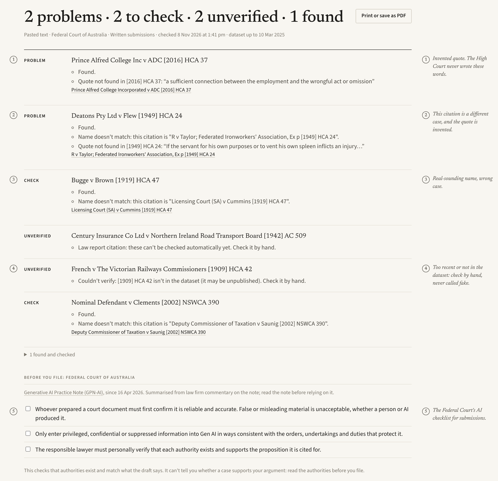
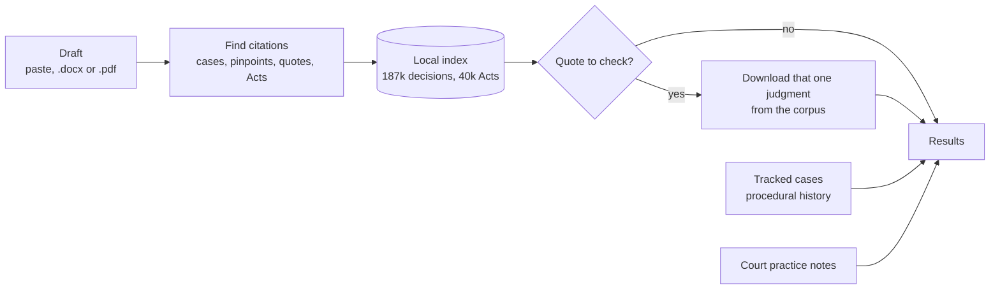
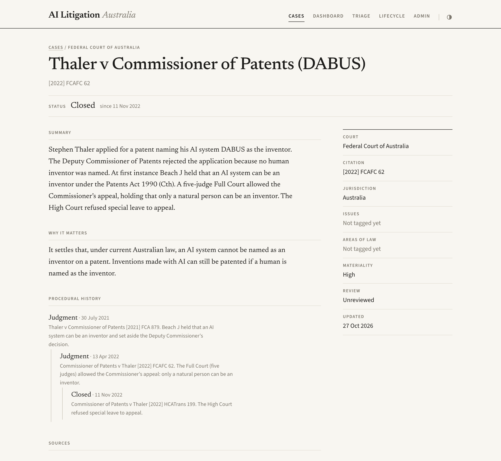
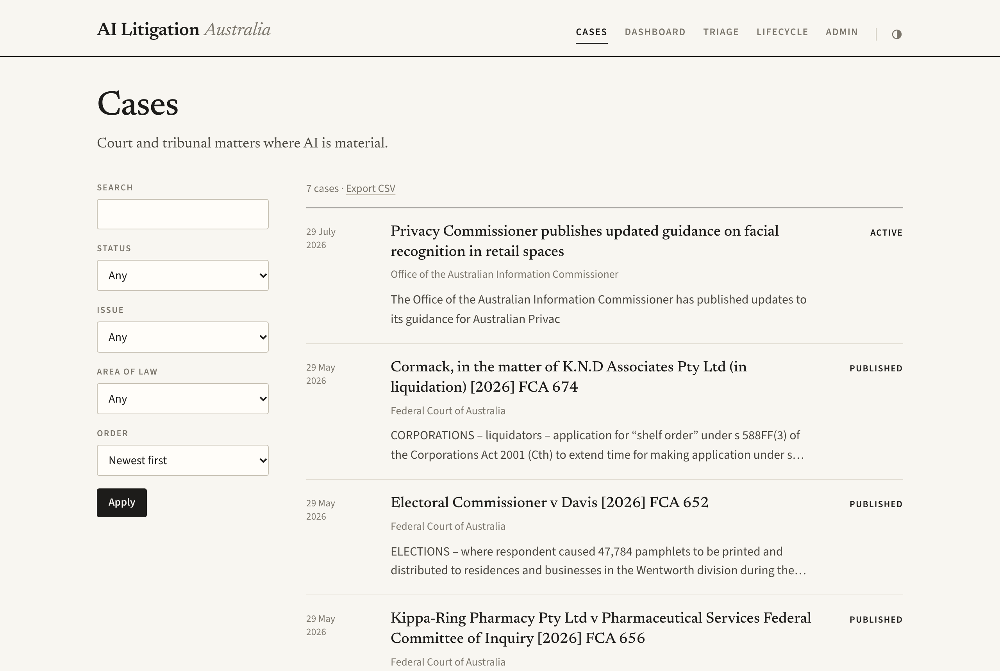
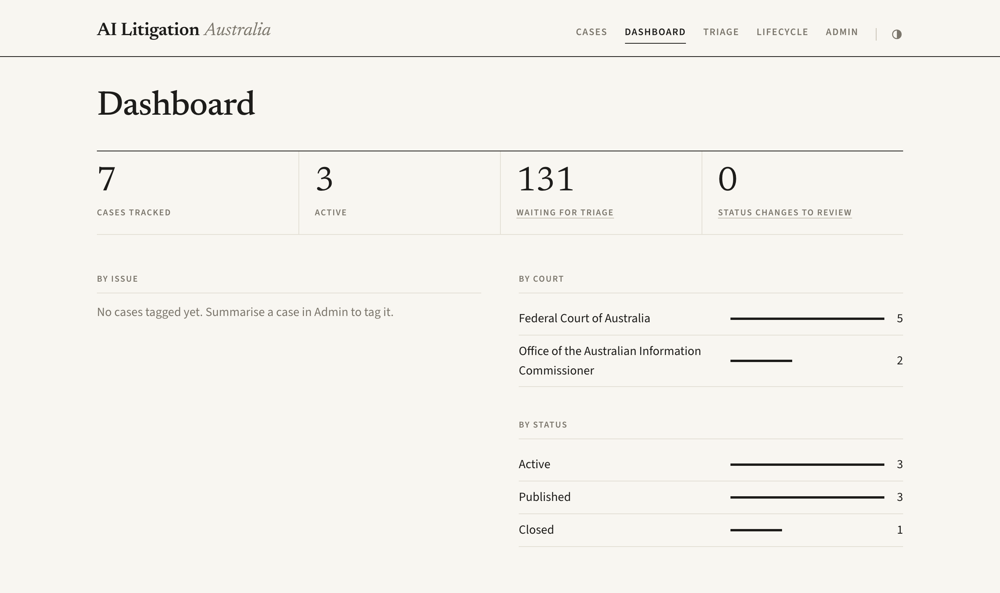
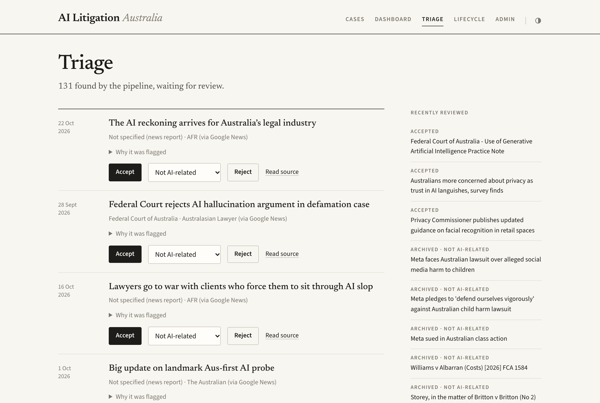
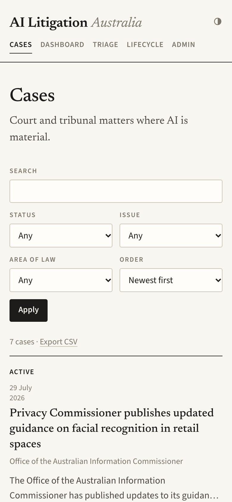

# AI Litigation Navigator

**Check a court document for AI-invented citations before you file it.** Paste a draft or upload a Word or PDF file. Every case and Act it cites is looked up against 187,000 Australian decisions: whether it exists, whether pinpoints and quotes match the judgment, and whether it was overturned on appeal. You also get the court's rules on AI use for that kind of document.

<picture>
  <source media="(prefers-color-scheme: dark)" srcset="docs/screenshots/check-annotated-dark.png">
  
</picture>

*A real test: submissions written by Gemini 2.5 Flash on employer liability for an employee's misuse of AI. Three of its six neutral citations belong to different cases, and both of its quotes are invented. In* Prince Alfred College *the High Court spoke of a sufficient connection "between the position for which he was employed and his wrongful conduct", not "between the employment and the wrongful act or omission".*

> **A personal project.** I built this to bring together my two interests, law and technology. It isn't legal advice or a commercial product, and it doesn't replace reading the authorities yourself.

## Contents

- [Why](#why)
- [What it checks](#what-it-checks)
- [How it works](#how-it-works)
- [Tested on real documents](#tested-on-real-documents)
- [The AI litigation tracker](#the-ai-litigation-tracker)
- [Getting started](#getting-started)
  - [The citation index](#the-citation-index)
  - [The tracker pipeline](#the-tracker-pipeline)
- [Limitations](#limitations)
- [Tech stack](#tech-stack)
- [Credits and licence](#credits-and-licence)

## Why

Australian courts have now dealt with AI-generated false citations or content in more than 100 decisions, and lawyers have been referred to their regulators over it. Generative AI produces case names, citations and quotations that look real. The Federal Court's generative AI practice note (GPN-AI, 2026) and the NSW Supreme Court's Practice Note SC Gen 23 both put the duty to verify on the person filing. Checking 40 citations by hand takes an hour, and it's the step that gets skipped.

## What it checks

| Check | Example result |
| --- | --- |
| The judgment exists | **Problem**: *[2023] FCA 2417* doesn't exist; Federal Court judgments for 2023 stop at 1,686 |
| The name matches the citation | **Check**: the citation belongs to a differently named case |
| The pinpoint exists | **Problem**: the judgment has 123 paragraphs, so [140] doesn't exist |
| The quote is in the judgment | **Problem**: these words don't appear in [2022] FCAFC 62 |
| It's still good law | **Check**: appealed in *Commissioner of Patents v Thaler* [2022] FCAFC 62; appeal allowed |
| The Act exists and is in force | **Check**: no Act in force with this title; it may have been repealed or renamed |
| The court's AI rules | A checklist from the practice note for the court and document type, with paragraph references |

Anything the dataset can't settle, such as Victorian decisions, law report citations or judgments newer than the dataset, is marked **Unverified** with a prompt to check it by hand, never **fake**. The results can be printed or saved as a PDF to keep as a record of the check.

## How it works



- **No AI.** Citations are found by pattern matching and checked against the [Open Australian Legal Corpus](https://huggingface.co/datasets/isaacus/open-australian-legal-corpus): Federal Court, High Court and NSW decisions, plus legislation from the Commonwealth, NSW, Qld, WA, SA and Tas.
- **The draft stays on the machine.** It's checked by the local server and never stored or sent anywhere. Only a cited judgment is downloaded when a quote needs checking.
- **Appeals** come from each appeal judgment's cover page ("Appeal from: …") and its orders ("appeal allowed"). **Later stages** come from the AI litigation tracker below.

## Tested on real documents

Two kinds of test: documents with known fake citations, to see that they're caught, and real filed documents, to see that real citations aren't called fake.

| Document | Result |
| --- | --- |
| Citations that Australian courts found had been invented or misattributed: *Luck v Commonwealth*, *Dias v Angle Auto Finance*, *Burton (No 5)*, *Egan v Commonwealth* | Every one caught. Two citations belong to different cases and two quotes aren't in the judgments; the invented *Victoria v Humphries* (2013) 228 FCR 145 is a law report citation, so it's marked unverified |
| Submissions written by Gemini 2.5 Flash (the screenshot above) | 3 of 6 neutral citations belong to different cases; both quotes invented |
| A Gemini-written contract claim for the NSW Supreme Court | 1 of 3 checkable citations belongs to a different case; 2 of its quotes are invented |
| 7 sets of submissions filed in the High Court in 2026 (*Archer*, *Haines* (both sides), *Mallard*, *Oil Basins*, *Smith*, *Yanunijarra*), 371 citations | **No false problems.** 8 warnings: Acts since repealed or renamed, a 2024 Queensland Act newer than the dataset's Queensland legislation, a judgment overturned on appeal, and the *Mental Health Cognitive Impairment Forensic Provisions Act 2020*, whose real title has an "and" in it. Most of the rest are law report citations, so unverified |
| 5 judgments of the Federal Court, Full Federal Court and NSW Supreme Court (*Killer Queen v Taylor*, *Singtel v FCT*, *Luck*, *Egan*, *Burton (No 5)*), 377 citations | **No false problems.** 231 found and checked. Warnings: Acts since repealed or renamed, the decision under appeal, and the fake *Nicholson v Heaven* that *Luck* itself discusses |

## The AI litigation tracker

Behind the checker, the app tracks AI-related cases in Australia:
- **Daily pipeline:** a scheduled job collects leads from courts, regulators, the [AI Hallucination Cases Database](https://www.damiencharlotin.com/hallucinations/) and news.
- **Screening:** Gemini screens each lead for AI relevance.
- **Review:** each lead waits in a triage queue for a person to accept or reject it.
- **Procedural history:** each case's history is kept as a dated tree (filed, judgment, appeal, settled), which sets the case's status.

<picture>
  <source media="(prefers-color-scheme: dark)" srcset="docs/screenshots/case-dark.png">
  
</picture>

<details>
<summary>More screenshots: case list, dashboard, triage queue, phone</summary>

<picture>
  <source media="(prefers-color-scheme: dark)" srcset="docs/screenshots/cases-dark.png">
  
</picture>

<picture>
  <source media="(prefers-color-scheme: dark)" srcset="docs/screenshots/dashboard-dark.png">
  
</picture>

<picture>
  <source media="(prefers-color-scheme: dark)" srcset="docs/screenshots/triage-dark.png">
  
</picture>

<picture>
  <source media="(prefers-color-scheme: dark)" srcset="docs/screenshots/mobile-dark.png">
  
</picture>

</details>

## Getting started

Requires Node.js 22.5 or later (for the built-in SQLite module).

```bash
npm run setup   # installs dependencies, sets up the database, downloads the citation index (about 18 MB)
npm run dev     # API on http://localhost:3001, app on http://localhost:3000
```

Open http://localhost:3000. It starts on the citation checker.

### The citation index

`npm run setup` downloads a prebuilt index of the corpus to `backend/data/corpus.db` (in `backend`: `npm run corpus:download`). To rebuild it from the full corpus (about 9.4 GB), or to store judgment text so quote checks also work offline:

```bash
cd backend
npm run corpus:import                          # streams the corpus from Hugging Face
npm run corpus:import -- path/to/corpus.jsonl  # or reads a downloaded copy
npm run corpus:import -- --full                # also stores judgment text (several GB)
```

### The tracker pipeline

```bash
npm run pipeline                                # ingest new leads, then check tracked cases for status changes
cd backend && npm run schedule:install          # run it daily at 7am (macOS); remove with schedule:remove
```

The pipeline needs a `GEMINI_API_KEY` in `backend/.env` for relevance screening and summaries; without one it falls back to keyword screening. New leads appear at `/admin/triage`.

<details>
<summary>Ingestion sources</summary>

- Federal Court judgments RSS, High Court judgments, Queensland CaseLaw alerts
- ASIC, ACCC, OAIC and eSafety media releases
- Federal Court generative AI practice guidance
- ClassActions.com.au newswire (also checked daily for settlements and dismissals of tracked cases)
- AI Hallucination Cases Database (Australian decisions)
- Google News search for Australian AI litigation

</details>

<details>
<summary>Database commands</summary>

- `npm run db:migrate`: apply Prisma migrations
- `npm run db:seed`: seed the taxonomy and sample cases
- `npm run db:reset`: recreate and reseed the database
- `npm run db:studio`: browse the data at http://localhost:5555

</details>

## Limitations

- **Dataset date:** the corpus runs to 10 March 2025. Newer judgments show as "too recent to check".
- **Missing courts:** Victorian, Queensland, WA, SA, Tasmanian, ACT and NT court decisions aren't in the corpus, and neither is Victorian, ACT or NT legislation. These show as unverified.
- **Law report citations:** citations like *(1992) 175 CLR 1* aren't checked yet. Neutral citations are.
- **Existence, not substance:** the checker confirms an authority exists and says what is quoted. It can't tell whether the authority supports the argument; that still needs a lawyer to read it.
- **Court rules:** only the Federal Court and NSW Supreme Court are covered. The Federal Court summary comes from law firm commentary, because the court's site blocks automated access; it links to the note itself.

## Tech stack

- **Frontend:** Next.js 16 (App Router), React 19, TypeScript, one plain CSS file, light and dark themes
- **Backend:** Express 5, TypeScript, Prisma with SQLite for the tracker, `node:sqlite` for the citation index
- **Other:** Gemini 2.5 Flash (tracker screening and summaries only); mammoth and pdf-parse (reading uploads)

| Folder | Contents |
| --- | --- |
| `backend/src` | API routes, citation checker (`citations.ts`, `citation-check.ts`, `corpus.ts`, `court-rules.ts`), ingestion pipeline |
| `backend/test` | Unit tests (`npm test` in `backend`) |
| `backend/prisma` | Tracker schema, migrations and seed data |
| `frontend/src` | Pages (`app`), components, server actions |

## Credits and licence

- **Citation data:** [Open Australian Legal Corpus](https://huggingface.co/datasets/isaacus/open-australian-legal-corpus) by Isaacus, CC BY 4.0.
- **Hallucination cases:** [AI Hallucination Cases Database](https://www.damiencharlotin.com/hallucinations/) by Damien Charlotin, CC BY 4.0.

Code: MIT.
