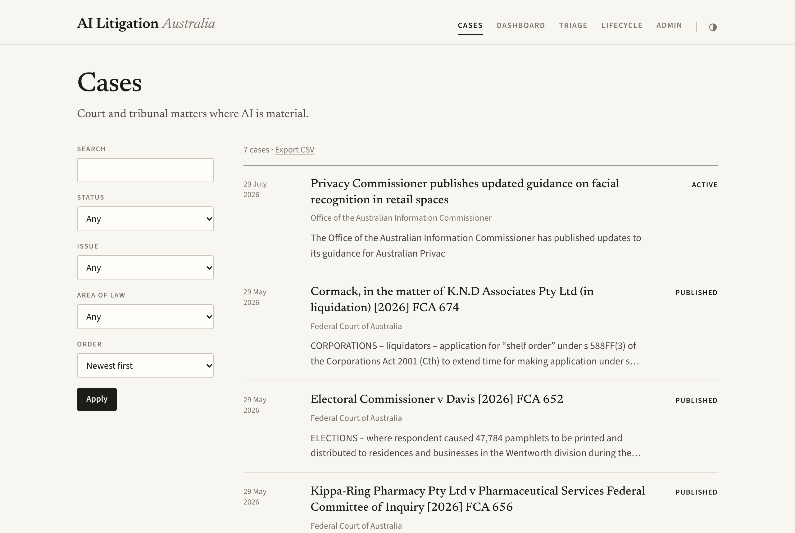
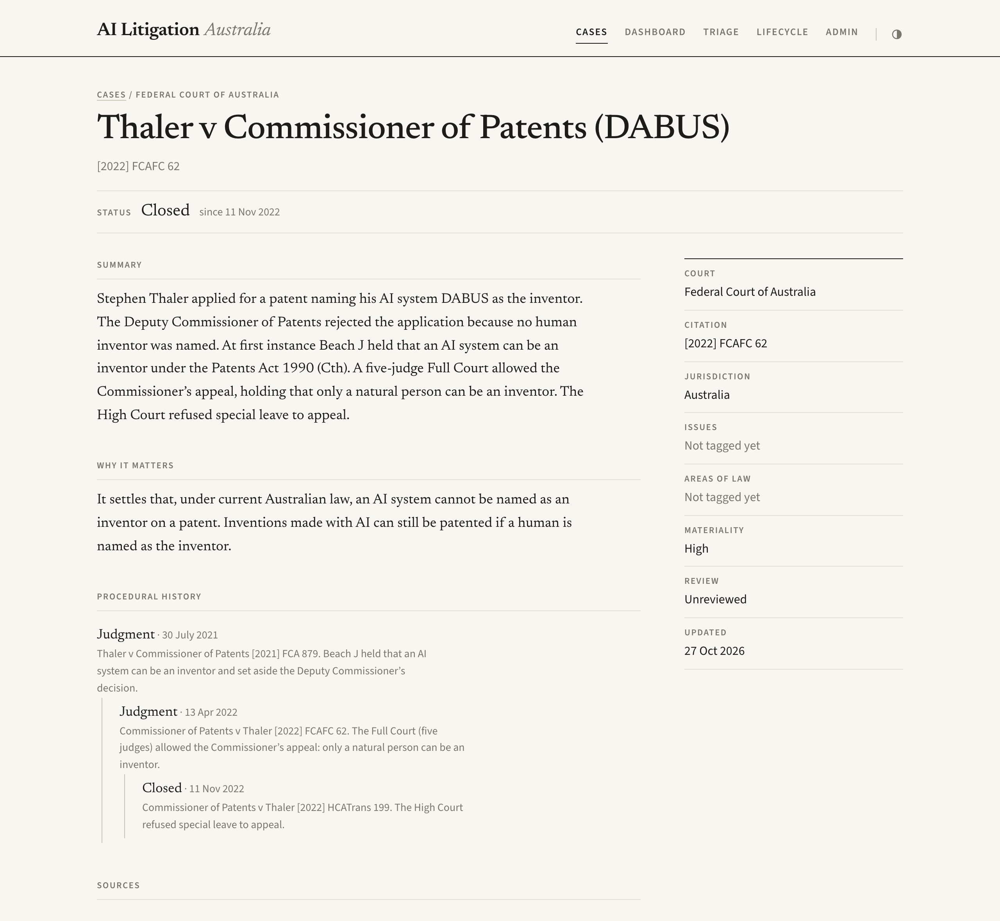
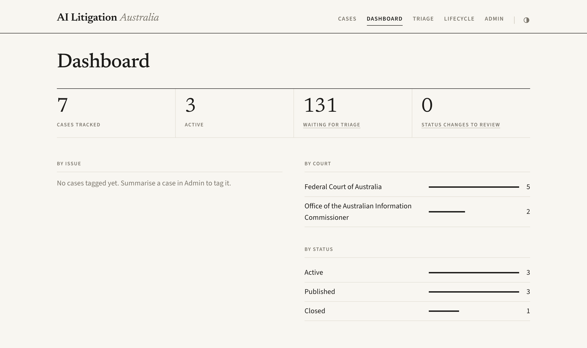
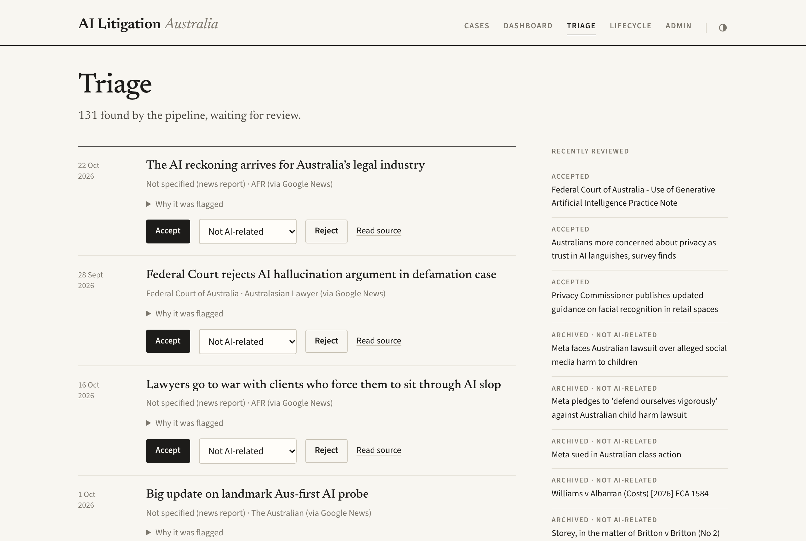
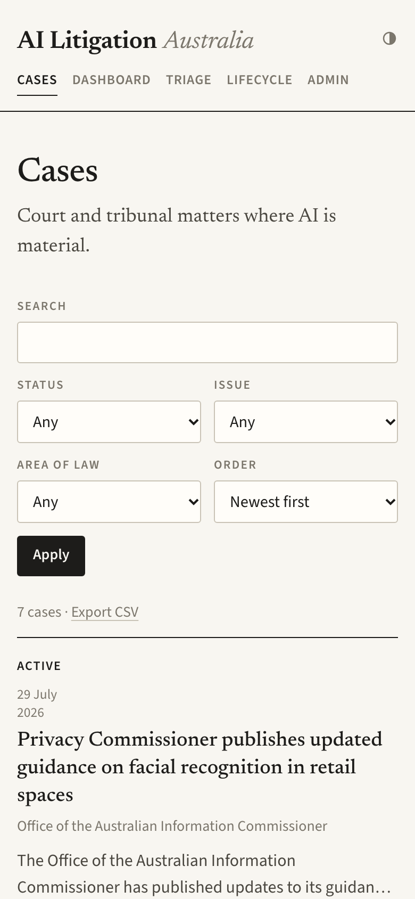

# AI Litigation Navigator

A full-stack legal intelligence platform designed to track and analyse AI-related court cases and tribunal decisions.

## Overview

The AI Litigation Navigator addresses the gap in public understanding of AI litigation by providing a carefully curated, broad, and structured view of disputes where AI is material. It supports faceted filtering by jurisdiction, issue type, legal area, and procedural status.

## Features

- **Searchable Case Database:** Track AI-related litigation across primary jurisdictions (US, Australia, etc.).
- **Faceted Filtering:** Filter by jurisdiction, issue type, legal area, and procedural status.
- **Structured Summaries:** Access carefully curated summaries of why specific cases matter.
- **Automated Ingestion:** Fetches court judgments, regulator releases, and court guidance from official sources and queues them for human triage.
- **AI Processing Pipeline:** Integrates Gemini AI to automatically determine relevance, generate structured summaries, and map cases to the taxonomy.
- **Triage Workflow:** Review ingested case candidates before accepting them into the public case database.
- **Admin Panel:** Built-in UI to create new case entries and delete existing cases from the database.


## Screenshots

**Case explorer**: filters on the left, cases as a dated index with each case's status on the right.

<picture>
  <source media="(prefers-color-scheme: dark)" srcset="docs/screenshots/cases-dark.png">
  
</picture>

**Case page**: status, summary, and the procedural history as a tree (here *Thaler v Commissioner of Patents*, the DABUS case: first instance, Full Court appeal, then High Court special leave refused).

<picture>
  <source media="(prefers-color-scheme: dark)" srcset="docs/screenshots/case-dark.png">
  
</picture>

**Dashboard** and **triage queue**

<picture>
  <source media="(prefers-color-scheme: dark)" srcset="docs/screenshots/dashboard-dark.png">
  
</picture>

<picture>
  <source media="(prefers-color-scheme: dark)" srcset="docs/screenshots/triage-dark.png">
  
</picture>

**On a phone**

<picture>
  <source media="(prefers-color-scheme: dark)" srcset="docs/screenshots/mobile-dark.png">
  
</picture>

## Tech Stack

This repository is structured as a monorepo containing:

### Frontend (`/frontend`)
- **Framework:** Next.js 14+ (App Router)
- **Language:** TypeScript
- **Styling:** one plain CSS file; Newsreader and Source Sans 3 via `next/font`; light and dark themes, following the system setting unless changed with the switch in the masthead

### Backend (`/backend`)
- **Server:** Express.js
- **Language:** TypeScript
- **Database ORM:** Prisma
- **Database:** SQLite (default for local development, easily swappable to PostgreSQL)

## Quick Start

### Prerequisites
- Node.js
- npm

### Installation and Setup

1. **Navigate to the project root:**
   ```bash
   cd /Users/adam/LegalTech
   ```

2. **Run the setup script:**
   This will install dependencies for both the frontend and backend, run Prisma database migrations, and seed the initial data.
   ```bash
   npm run setup
   ```

### Running Locally

You can start the development servers using the provided `dev.sh` script or NPM commands.

To run both concurrently using the shell script:
```bash
npm run dev
```

**Manual Start:**

Terminal 1 (Backend):
```bash
npm run backend
# API server runs on http://localhost:3001
```

Terminal 2 (Frontend):
```bash
npm run frontend
# Next.js app available at http://localhost:3000
```

## Database Management

The project uses Prisma as its ORM. The following commands can be run from the root directory to interact with the backend database:

- `npm run db:migrate`: Run Prisma migrations to update the database schema.
- `npm run db:seed`: Seed the database with initial taxonomy (issues, legal areas) and case data.
- `npm run db:reset`: Reset the SQLite database and reseed it.
- `npm run db:studio`: Open Prisma Studio at `http://localhost:5555` to view and edit data visually.

## Ingesting New Cases

Run the pipeline (ingestion, then lifecycle signal detection) from the project root:

```bash
npm run pipeline
```

Output is appended to `backend/logs/pipeline.log`. To run it every day at 7am (macOS launchd; a run missed while the Mac is asleep happens on wake):

```bash
cd backend
npm run schedule:install   # remove with: npm run schedule:remove
```

Ingestion fetches Australian court, regulator, guidance, and AI-specific sources, applies the keyword and LLM relevance screens, and creates triage candidates instead of publishing cases directly. Review new candidates at `/admin/triage`; accepting a candidate creates the case record and links the primary source.

Each ingested candidate stores evidence for review, including matched keywords, source adapter name, source category, extraction method, LLM screening status, duplicate check result, and fetch timestamp.

Current ingestion adapters include:

- Federal Court judgments RSS
- Queensland CaseLaw alerts
- High Court judgments page
- ASIC media releases
- ACCC media releases
- OAIC media centre
- eSafety media releases
- Federal Court generative AI practice guidance
- ClassActions.com.au newswire
- [AI Hallucination Cases Database](https://www.damiencharlotin.com/hallucinations/) (Australian decisions; CC BY 4.0, pre-screened as AI-relevant)
- Google News search for Australian AI litigation coverage

## Project Structure

- `backend/`: Express API server, route handlers, and Prisma schema (`schema.prisma`), migrations, and seed scripts.
- `frontend/`: Next.js application (`src/app`), React components (`src/components`), Server Actions (`src/actions`), and styling.

## License

MIT License. See `package.json` for more details.
